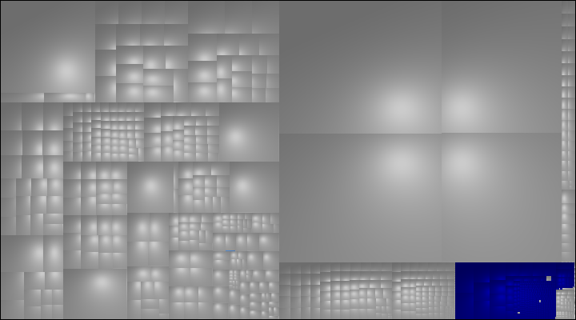
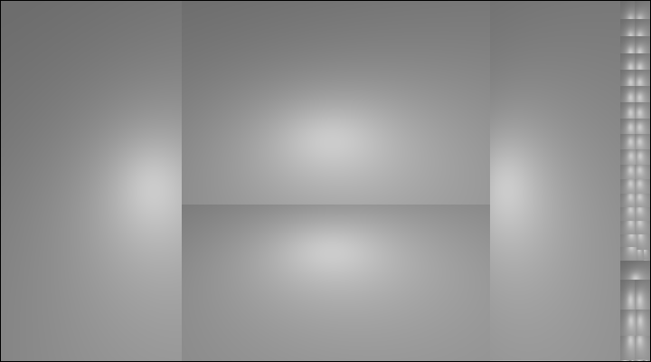

# What’s taking up space in the fonts folder?

On one Linux machine, the system fonts took up 220 MiB. Was that a little space spent on each of a thousand fonts, or could a handful of files explain most of it? Here’s what GdMap saw when we opened the folder.



Each tile represents a file. Twice the area means twice the size. Neighboring tiles are grouped by folder, and the same color can appear on many files with the same extension. Pick a large tile and GdMap can tell you exactly which file you’re looking at.

## Get a map of your own

From the repository root, after the [local install](../README.md#build-and-run-on-linux), run these lines in one shell. The scan saves a snapshot in a fresh temporary directory outside the fonts folder. If you already have a snapshot, set `snap` to its path and skip the scan.

```sh
cli=./build/local/bin/gdmap-cli
work=$(mktemp -d)
snap="$work/fonts.gdmap"
"$cli" scan /usr/share/fonts "$snap" > /dev/null
"$cli" explore "$snap" --width 720 --height 400
```

The scan also prints one row per entry, which is why we redirect its output here. Everything after the scan reads the saved tree. You can revisit it after the original files have moved.

You’ll get a list of the largest files, the heaviest branches and any repeated folder names. Now type these two lines **inside the session**. Node `0` is the root of your scan.

```text
expand 0
map 0
```

Open the PNG path printed on the `image` line. Our pictures came from the fonts branch of a larger snapshot. Your installed fonts, node numbers and tile positions can differ. Use the numbers in your own output as you follow along.

## Follow one tile home

On the first map, try a point 100 pixels from the left and 100 from the top. Coordinates use the original 720 × 400 image.

```text
hit 100 100
```

Our result was `/usr/share/fonts/truetype/noto/NotoColorEmoji.ttf`, at 11,085,148 bytes. The second row identified its parent folder, `truetype/noto`. To see what sits beside that font, enter `expand` followed by the parent’s node number. The number works even when the path contains spaces or unusual characters.

But how much did that tile explain? The earlier expansion of the fonts folder put it in perspective. Here are the first four children from our run.

| Folder | Size | Regular files | Share taken by its largest file |
| --- | ---: | ---: | ---: |
| truetype | 106.8 MiB | 388 | 9.90% |
| opentype | 93.0 MiB | 52 | 27.98% |
| type1 | 11.9 MiB | 179 | 1.34% |
| X11 | 8.0 MiB | 505 | 8.78% |

Look at `opentype`. It used almost as much space as `truetype` with just 52 files. Take the node number from its row and type `map` followed by that number. In our session the command was `map 5243691`.



The whole frame now represents 93 MiB. On this map, `hit 100 100` landed on a different file, `opentype/noto/NotoSerifCJK-Bold.ttc` (26.0 MiB). Expanding the parent showed that **four font collections accounted for 88.8 MiB**, about 95% of the entire opentype branch. They were the regular and bold versions of Noto Serif CJK and Noto Sans CJK. The only other file in their folder was a 36-byte identifier. That’s an answer you can check and report, right down to the path.

Use `overview` to see the opening summary again, `help` for the session commands, and `quit` to return to the shell. A temporary map lasts until you map another branch or leave the session.

## Keep the picture and the evidence

To save a map you can inspect tomorrow, render it from the same snapshot. This time select the branch by its original absolute path. Substitute a folder from your snapshot if it has no `opentype` directory.

```sh
"$cli" render "$snap" "$work/opentype.png" --path /usr/share/fonts/opentype --width 720 --height 400 --lighting 0.55
"$cli" hit "$work/opentype.png.frame" --x 100 --y 100
```

You get a PNG to share and a small companion file ending in `.frame`. The frame records the snapshot path, checksum, map settings and color legend. For later point lookups, keep the frame and leave the snapshot at its recorded path. If you view the picture at half size, the same point is now (50, 50). Let the CLI convert it back.

```sh
"$cli" hit "$work/opentype.png.frame" --x 50 --y 50 --preview-width 360 --preview-height 200
```

Use `--parent` to select the enclosing folder. To simplify a busy picture, render with `--depth 2` to stop two levels below the selected folder. Try `--mode standard` for alternating horizontal and vertical splits, or keep the default `square` layout. Adjust `--lighting` from 0 (flat) to 1 (full shading), or pass `--palette /path/to/colors.xml` for your own GdMap colors. Use the frame from the picture you clicked.

## Ask the same questions from a script

For a single question, run one command in your shell. For example, these give you the top five results per overview section, the immediate children of one folder, and a complete table for your own analysis.

```sh
"$cli" overview "$snap" --limit 5
"$cli" expand "$snap" --path /usr/share/fonts/opentype
"$cli" inspect "$snap" > "$work/files.tsv"
```

The table includes node, parent, kind, bytes and original path. Paths are C-escaped in output. To select an entry again, pass its number with `--node` to `expand` or `render`. Numbers are stable within one snapshot. The overview’s ranked branches can contain one another, so adding those rows would count some bytes twice.

For a series of questions, keep the tree in memory. An agent driving `explore` reads through the first line containing only `end`, sends one command per line, and reads through `end` after each response. To automate just folder expansions or just point lookups, use the corresponding batch mode.

```sh
printf '0\nquit\n' | "$cli" expand "$snap" --batch
printf '100 100\nparent 100 100\nquit\n' | "$cli" hit "$work/opentype.png.frame" --batch
```

Both batch commands announce `ready` and finish each query response with `end`. A point on the outer border returns `miss`. Choose a point inside a tile and try again.

## When you scan a different folder

Replace `/usr/share/fonts` in the scan command with the directory you want to investigate, and choose a new snapshot path outside it. By default the scan stays on the starting filesystem and counts reported file sizes. Add `--leave-device` to cross mount points or `--allocated-size` to use allocated bytes when positive and smaller than the reported size. Hard links count once per name, symbolic links count their own size, and inaccessible entries can be skipped. Keep those rules in mind when using the result to estimate how much a cleanup would free.
